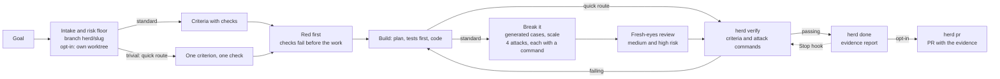
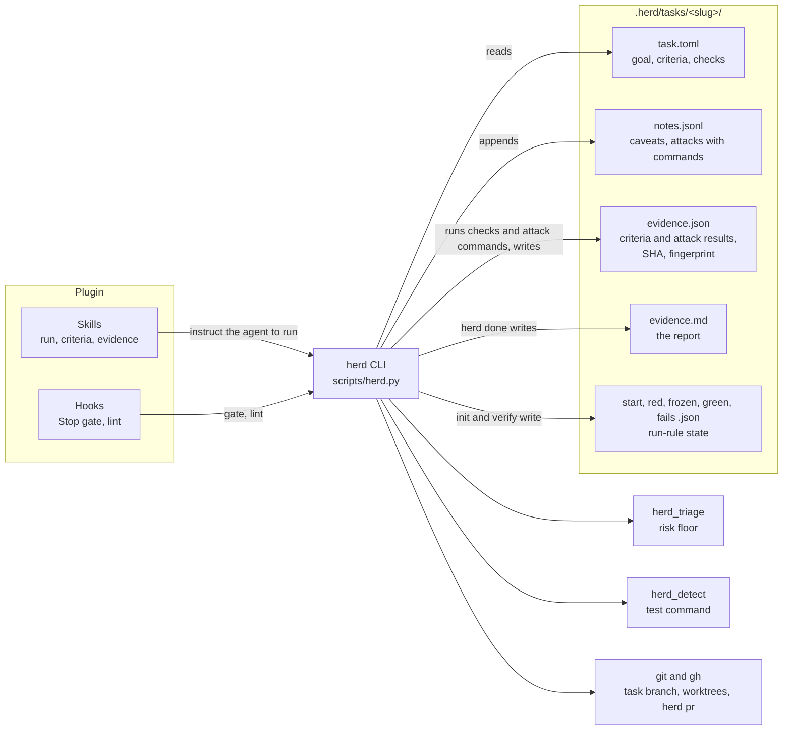
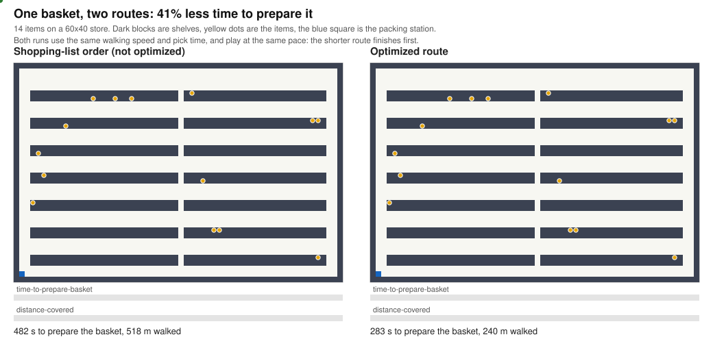
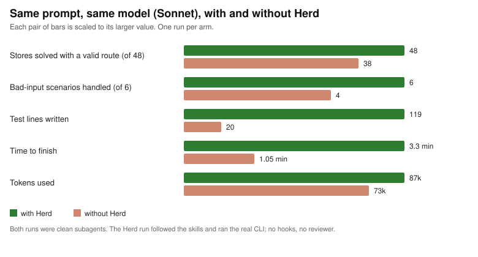

<p align="center">
  <picture>
    <source media="(prefers-color-scheme: dark)" srcset="assets/logo-dark.svg">
    
  </picture>
</p>

<h3 align="center">Hand an agent a goal. Get back code and proof.</h3>

<p align="center">
  <a href="https://github.com/Beovulfo/herd-sdlc/actions/workflows/ci.yml"></a>
  <a href="LICENSE"></a>
  
  
</p>

<p align="center">
  <a href="#quickstart">Quickstart</a> &middot;
  <a href="#how-it-works">How it works</a> &middot;
  <a href="#architecture">Architecture</a> &middot;
  <a href="#several-tasks-at-once">Parallel tasks</a> &middot;
  <a href="#see-it-work">See it work</a> &middot;
  <a href="#benchmark-with-and-without-herd">Benchmark</a> &middot;
  <a href="#commands-and-skills">Commands</a> &middot;
  <a href="#the-design-behind-it">Design</a>
</p>

<p align="center">
  
  <br><sub>A real session with Herd 0.3.2 and Claude Sonnet 5.5, sped up: one message, then intake, criteria, red first, build, break it, review, verify and evidence. The Stop gate blocks one early finish.</sub>
</p>

Herd is a lightweight [Claude Code](https://claude.com/claude-code) plugin that runs a task end to end with as little human input as possible. You give it a goal and, if you like, success criteria. The agent plans, builds, tries to break its own work, reviews and verifies. It only stops when **runnable checks prove the criteria pass**, and it only asks you something when an action is irreversible or a real trade-off needs a human.

Most agent workflows ask people to write long requirement lists, then trust the agent when it says "done". Herd flips that:

| You provide | The agent provides |
| --- | --- |
| A goal, and optionally criteria with a check for each | Plan, code, tests, adversarial pass, review, and **evidence** |

You review evidence (command output, commit SHA, timestamps), not process.

**Why use it**
- **Done means proven.** A Stop hook blocks the agent from finishing until every check passes, with evidence newer than the last edit.
- **Your words stay yours.** Criteria you write are quoted verbatim and never weakened. Gaps are filled by the agent and marked `agent-proposed`.
- **Caveats surface early.** The agent must say what each check does not prove, try to break its own work, and log what it finds, so problems appear during the run, not after it.
- **Checks that test nothing are caught.** A check that exits 0 but ran zero tests is flagged instead of counted as proof.
- **The pull request is the evidence (opt-in).** `herd pr` opens a PR whose description shows what is proven and by which check, what is not, and how to reproduce it. It never merges.
- **Short by default.** Commands print a line or two, the agent ends with a seven-line report, and the pull request collapses its details. The full detail is one flag or one file away.
- **Several tasks at once (opt-in).** `herd init --worktree` gives each task its own branch and git worktree, so several agents can work in one repository without touching each other.
- **Light.** A small Python CLI on the standard library, no dependencies, plain-text task files. It reuses [Superpowers](https://github.com/obra/superpowers) and [EGM](https://github.com/google/elephant-goldfish-model) when they are installed.

## Quickstart

You need Claude Code, Python 3.11 or newer as `python3`, and a git repository. With an older `python3` the hooks stay silent and do nothing, and the CLI says which version it needs.

```text
/plugin marketplace add Beovulfo/herd-sdlc
/plugin install herd@herd-sdlc
```

The same from a terminal:

```bash
claude plugin marketplace add Beovulfo/herd-sdlc
claude plugin install herd@herd-sdlc
```

Optional, and recommended, the plugins Herd builds on. Herd works without them and uses them when present:

```bash
claude plugin install superpowers@claude-plugins-official
claude plugin marketplace add google/elephant-goldfish-model
claude plugin install egm@egm
```

Then, inside your project, in a new session:

```text
/herd:run Add a --json flag to the export command. Output must be valid JSON with every row.
```

Herd creates the task, writes criteria with checks and shows them to you, runs them once to see them fail, builds on a `herd/<slug>` branch, tries to break the result, gets a fresh-context review, verifies, and ends with a seven-line report that links the full evidence in `evidence.md`. High-risk changes get one approval question before building. For a trivial change, say "quick fix": one check, no ceremony. To plan with Herd how to prove a change for your project type, run `/herd:evidence`.

Two options are off by default; ask for them in the request, or switch them on in `herd.toml` ([settings](#project-settings-herdtoml)):

```text
/herd:run In its own worktree, add a --json flag to the export command. Open a PR when done.
```

The task then runs on a new branch in its own worktree, cut from the branch you are on, and ends with a pull request whose description is the evidence.

## How it works



1. **Intake.** The task gets a folder, `.herd/tasks/<slug>/task.toml`, and a risk floor computed from path rules in `herd.toml` (migrations, auth, billing, and so on). The agent can raise the risk, never lower it. A trivial change takes the **quick route**: one criterion and one check, no criteria interview, no approval question, no review. It is refused at a `high` risk floor and still ends in fresh passing evidence. With `--worktree` (opt-in) the task starts on its own branch in its own git worktree: see [Several tasks at once](#several-tasks-at-once).
2. **Criteria.** Every criterion has a `check`: a shell command where exit 0 means pass. Criteria you write are authoritative: the agent quotes your words, adds a `coverage` note saying what the check proves and what it does not, and the report flags any `human` criterion that is not a verbatim quote. A criterion with no check is `unchecked` and is never counted as met. `herd detect` proposes the project's real test command. Before any work, `herd verify` runs the checks once: they should fail (red first), and the report shows how many did.
3. **Build.** Tests first, small steps, on a branch. Superpowers is used for planning, TDD and subagents when installed. `herd init` records the starting commit, the stash list and any files already uncommitted (those are yours, not the agent's, until the agent changes them), so the first `herd verify` knows whether code was written before the checks, including code moved aside or stashed for that run (a check by file times and the stash list, not proof): if it was, the report says "red first not proven" and `herd done` waits for the agent's reason (`herd note --late-red`).
4. **Break it, then review.** The agent tries to break its own work on exactly what the request promises: the words `any`, `every`, `very big` become generated cases of different shapes and a scale run. It always also runs four standard attacks: bad input at every entry point, collisions, one broken entry it does not need, and a recount of every reported number from the output. Each attack is logged with a command that shows it (`herd note --tried --attack <name> --check "<command>"`); `herd verify` runs these commands like criterion checks, and `herd done` and the Stop gate refuse until each attack has one that passes (or an `n/a:` reason). Each attempt, failure and fix is logged with `herd note`. For medium (the default) and high risk, a fresh-context reviewer then looks at the finished diff, and the agent records it with `herd review --by` (or `herd review --skipped` and the reason, which marks the change unreviewed). A review counts only when it is recorded after all checks first passed and at the current risk or higher; at high risk it must also have seen the final content (committing after it is fine, changing a file is not), and below that, code changed after it is shown in the report. A skipped review counts at any risk, so an agent with no reviewer can finish, but the report and the PR call the change unreviewed. The risk is stored at `herd init` and raised when the changed files match a `[floor]` rule.
5. **Verify.** `herd verify` runs every check and stores evidence: status, exit code, output tail, commit SHA, a fingerprint of the workspace, a timestamp, how many checks failed on the first run (a check that was green before any work is visible), and the wall-clock time since `herd init`. A check that exits 0 but whose output says it ran zero tests (`Ran 0 tests`, `no tests ran`, `[no test files]` and the like) is marked in the evidence and the report warns about it. The warning is advisory: the Stop gate does not change. It also runs the `herd check` warnings every time, freezes the human criteria at the first run (changing or removing one later blocks `herd done` until the human's own words are recorded with `herd note --human-change "C1: ..."`, quoting the new text or saying it was dropped; the same holds for a changed check on a human criterion, and a changed check on an agent's criterion is shown), and counts failures in a row: after 3 on one criterion it says to escalate. The command prints one summary line plus only what needs attention.
6. **Stop gate.** While a task is active, a Stop hook refuses to let the agent finish unless the evidence is fresh and passing, every standard attack has a passing command, red first is proven or explained, the human criteria are unchanged and a review is recorded where the risk needs one. Edit a file after verifying and the evidence is stale. Once all of that holds, it still blocks up to 3 times until `herd done` runs, which checks the commit and prints the final report. If Herd's own state files are corrupt, it blocks and says which; with no `start.json` (a task started before 0.4.0, or the file deleted), red first needs a `herd note --late-red` reason. After 3 blocked attempts on a problem the gate lets the agent stop so it can ask you one question instead of looping. To drop a task, `herd cancel` closes it and keeps its files as a record.
7. **Pull request (opt-in).** When the request asks for a PR, or `herd.toml` has `[pr] open = true`, `herd pr` pushes the task's `herd/<slug>` branch and opens a pull request whose description is the evidence: the result, what is proven and by which check, what is not proven (failing or unchecked criteria, coverage gaps, known limits, open caveats), then, collapsed, the run details, the caveat log and the commands to reproduce. `herd done` then replaces the description with the final evidence (run `herd pr` again any time to refresh it; it shows stale evidence as stale). It needs a clean working tree, so the PR holds exactly the verified code. It leaves check output out of the description (it can hold secrets) but publishes the check commands, the criteria and the notes as written, so never put a secret in them. It pushes no other branch and never merges: you review the evidence and merge.

### Several tasks at once

Herd keeps a task's state in the checkout it runs in, so a plain `herd init` refuses while another task there is still active. To run several tasks in one repository, start each in its own worktree:

```text
$ herd init export-json "Add a --json flag to the export command" --worktree
created worktree <repo>/.claude/worktrees/herd-export-json on branch herd/export-json, cut from feature/reports. Work from there: in Claude Code, EnterWorktree with that path; otherwise cd into it. Run every herd command from it.
```

- **Its own branch, cut from where you are.** `herd/<slug>` starts at the current local branch, which is recorded as the task's base; `herd pr` opens the pull request against it. A plain `herd init` does the same in the current checkout, without a new folder.
- **Its own state.** The task's files and Stop gate live in the worktree. Other agents can start other tasks from the same branch at the same time; each gate sees only its own task, and a duplicate task name fails without touching the first.
- **A forgotten move fails loudly.** `herd` commands run from the starting checkout for a task that lives in a worktree refuse and name the worktree.
- **Clean main checkout.** Herd adds `/.claude/worktrees/` and `.herd/` to the repository's own `.git/info/exclude` (never committed), so other tasks never show up in `git status` or a `git add -A`.
- **Make it the rule.** With `[worktree] required = true` in `herd.toml`, a plain `herd init` refuses outside a matching worktree.
- **Clean up after the merge** with `git worktree remove .claude/worktrees/herd-<slug>`. Uncommitted changes in the starting checkout are not carried over; Herd warns when there are some.

## Architecture



- **Short skills, details on demand, quality first.** The run skill holds the steps; the quick route, the worktree start, the adversarial pass and the PR step are separate files the agent must read in full when that step applies. Where skipping a step would cost quality, the CLI enforces it itself at `herd done` and the Stop gate: the adversarial attacks, red first, the review, the frozen human criteria and the commit. Budget tests keep the skills and the command output from growing back.
- **The skills are the method; the CLI is the referee.** The skills tell the agent what to do in each step. The CLI only records and checks: it runs the commands in `task.toml` and decides from their exit codes, never from what the agent says.
- **The Stop hook enforces it.** It asks the CLI whether the stored evidence is passing, meets the run rules and still matches the workspace: a SHA-1 over `HEAD`, the diff and untracked files, plus a hash of `task.toml`. Any edit after `herd verify` makes the evidence stale. The hook finds the task from any subdirectory: the root is the nearest folder with `.herd/` or `herd.toml`, so a project in a subfolder of a repository keeps its own tasks.
- **State is plain files** in the project, one folder per task (in the task's own worktree when it has one), so a human can read, diff or delete it.
- **GitHub only when you opt in.** `herd pr` uses the `gh` CLI to push the task's branch and open its pull request. Nothing else talks to a service.
- **Two modules are not wired in yet.** `herd_arbiter.py` (rules on review findings) and `herd_escalation.py` (one GitHub issue to pause and ask a human) are tested building blocks for the GitHub automation on the roadmap.

## See it work

A task is a goal plus criteria, each with a runnable check:

```toml
goal = "Add a slugify(text) function"
known_limits = "ASCII text only; non-Latin scripts are not handled"

[[criteria]]
id = "C1"
text = "Given 'Hello, World!', when slugify runs, then it returns 'hello-world'"
source = "human"
coverage = "proves the basic case and punctuation; does not prove accents or very long input"
check = "python3 -m unittest test_textutil.TestSlugify.test_basic"

[[criteria]]
id = "C2"
text = "Given only punctuation, when slugify runs, then it returns an empty string"
source = "agent-proposed"
check = "python3 -m unittest test_textutil.TestSlugify.test_empty"
```

Before any work, both checks fail, which proves they test something. After the work (output abridged):

```text
$ herd verify
2 passing, 0 failing, 0 unchecked

$ herd done
done: evidence is fresh and passing (2 of 2 criteria proven)
report: .herd/tasks/slugify/evidence.md
```

`herd verify` lists a criterion only when it needs attention (failing, unchecked, or ran zero tests); `--verbose` lists all. The report in `evidence.md` (also `herd done --verbose`):

```text
# Evidence: slugify
Result: 2 passing, 0 failing, 0 unchecked
First verify: 2 of 2 checks failed before the work
Elapsed: 2m 05s from herd init to this verify; first verify at 0m 40s (wall clock, includes any waiting on the human)
Known limits: ASCII text only; non-Latin scripts are not handled
Adversarial pass: 5 attempts recorded; bad-input passing (`python3 -m unittest test_textutil.TestBadInput`); collision n/a; one-bad-part n/a; recount passing (`python3 -m unittest test_textutil.TestRecount`)
| id | status | source | check |
| C1 | passing | human | `python3 -m unittest test_textutil.TestSlugify.test_basic` |
| C2 | passing | agent-proposed | `python3 -m unittest test_textutil.TestSlugify.test_empty` |
```

The agent's final message to you is seven lines, filled from the report and linking it instead of repeating it:

```text
Done: added slugify(text) in textutil.py.
Proven: 2 of 2 criteria; evidence in .herd/tasks/slugify/evidence.md.
Not proven: accents and very long input (C1 coverage).
Caveats: found that an empty string crashed (0m 50s), fixed (1m 10s).
Decisions: none.
Limits: ASCII text only; non-Latin scripts are not handled.
Review: fresh-context subagent, no Blocker or Major findings.
```

With `herd pr`, the same evidence becomes the pull request description (abridged):

```markdown
# Evidence: slugify

**Result:** 2 of 2 criteria proven by a passing check (0 failing, 0 unchecked).

The evidence is fresh: the checks ran at 2026-11-23T10:02:11Z on commit `4cd7bd83130f`.

## What is proven
| id | source | criterion | proof: the check that passed |
| C1 | human | Given 'Hello, World!', when slugify runs, then it returns 'hello-world' | `python3 -m unittest test_textutil.TestSlugify.test_basic` exit 0 |

## What is not proven
- C1, what its check proves and does not: proves the basic case and punctuation; does not prove accents or very long input
- Known limits: ASCII text only; non-Latin scripts are not handled

<details><summary>Run details and caveat log (2 tried, 0 found, 0 fixed)</summary> ... </details>
<details><summary>Reproduce: run from the repository root</summary> ... </details>
```

Long check commands are cut in the table and shown in full under Reproduce.

If the agent tries to finish while a check is failing, the Stop hook answers instead:

```text
{"decision": "block", "reason": "Herd task `slugify` is not done (1/3 stop attempts blocked).
 C1 is failing: Given 'Hello, World!', ... Run `herd.py verify` after fixing. ..."}
```

## Benchmark: with and without Herd

<p align="center">
  
</p>

One short prompt, a route optimizer for picking a shopping list in a supermarket that "works for any layout, even very big ones", was given **6 times each** to four arms: Claude Sonnet 5.5 and Claude Haiku 5.5, each with **Herd 0.3.1** and with no workflow. Every solution was then checked by a hidden verifier it had never seen: 48 generated stores from eight layout families, up to 600 by 400 cells with 200 items, with every walk validated step by step, plus six bad-input scenarios.

<p align="center">
  
</p>

Mean ± standard deviation over 6 runs per arm:

| | Sonnet + Herd | Sonnet, no workflow | Haiku + Herd | Haiku, no workflow |
| --- | --- | --- | --- | --- |
| Stores solved with a valid route, of 48 | **48.0 ± 0.0** | 45.2 ± 4.8 | 44.3 ± 2.0 | 41.7 ± 2.7 |
| Runs with every store valid | **6 of 6** | 3 of 6 | 1 of 6 | 0 of 6 |
| Bad-input scenarios handled, of 6 | **6.0 ± 0.0** | 3.5 ± 0.5 | **6.0 ± 0.0** | 4.3 ± 2.0 |
| Time saved against list order, mid stores | 66.8 ± 1.3% | 66.7 ± 1.1% | 68.2 ± 1.8% | 66.8 ± 1.4% |
| Time to a finished result | 4.2 ± 1.2 min | 1.1 ± 0.2 min | 10.3 ± 5.5 min | 2.7 ± 0.9 min |
| Estimated cost per run, API list prices | $0.61 ± 0.09 | $0.29 ± 0.03 | $0.29 ± 0.09 | $0.04 ± 0.02 |

<p align="center">
  
</p>

- **Sonnet with Herd never failed.** All 6 runs solved all 48 stores and handled all six bad inputs. Without Herd, 3 of 6 Sonnet runs lost stores (up to 12), and all six crashed on a malformed map.
- **Bad input is safe with Herd on both models.** All 12 Herd runs handled 6 of 6 bad inputs; without Herd the average was 3.5 (Sonnet) and 4.3 (Haiku).
- **The route itself is not better.** Once a store is solved, every arm saves about the same time against list order. Herd buys robustness and evidence, not a better optimizer.
- **Haiku is cheaper but not as good.** Haiku with Herd costs half of Sonnet with Herd and matches it on bad input, but loses 3.7 stores per run, almost all to one bug (a product picked from a sealed side of its shelf). For the same $0.29 as Sonnet without a workflow, it is safer on bad input and solves about as many stores.
- **It costs more.** Herd runs make about 4 times as many model requests: about 2 times the cost on Sonnet and 8 times on Haiku, and 4 times the time.

One task, emulated Herd sessions (no Stop hook, no reviewer), costs estimated from each run's own token log at API list prices. The method, every number, the failure analysis and these limits are in [`examples/supermarket-route/BENCHMARK.md`](examples/supermarket-route/BENCHMARK.md). To score one run:

```bash
sh examples/supermarket-route/verifier/score_run.sh sonnet-herd-1
```

## Commands and skills

| What | Does |
| --- | --- |
| `/herd:run <task>` | The autopilot: intake, criteria, build, break it, review, verify, evidence |
| `/herd:criteria` | Write success criteria with runnable checks |
| `/herd:evidence` | Interactive: decide with you how to prove the change works for your project type |
| `herd init <slug> "<goal>" --request "<message>"` | Create a task, make it active, and switch to a new `herd/<slug>` branch cut from the current one (uncommitted changes come along; it warns instead on a detached HEAD or a repository with no commit). `--request` stores the human's message verbatim so `herd check` can flag human criteria that are not quotes |
| `herd init <slug> "<goal>" --quick "<check>"` | Quick route for a trivial change: one criterion, one check. Refused at a `high` risk floor |
| `herd init <slug> "<goal>" --worktree` | Opt-in: start the task on a new `herd/<slug>` branch in its own worktree at `.claude/worktrees/herd-<slug>`, cut from the current local branch, so several agents can run tasks in one repository. `[worktree] required = true` in `herd.toml` makes it mandatory |
| `herd check` | Validate `task.toml`; warns about criterion texts over 40 words, coverage notes over 50 words, checks that do not run project code, human criteria that are not quotes, missing `coverage` or `known_limits`, and quantifier or size words (`any`, `every`, `very big`) whose `coverage` does not say what varies or what scale was tried |
| `herd detect` | Propose test and lint commands for Python, Node, Rust, Go and `make test` |
| `herd note --found\|--fixed\|--open\|--decision\|--late-red\|--human-change\|--tried [--attack <name> --check "<command>"] "text"` | Log a caveat, a decision, the reason code came before red first, the human's own change to a frozen criterion (`"C1: <their words>"`), or an adversarial attempt, with a timestamp; the report lists them. `--attack` names a standard attack (`bad-input`, `collision`, `one-bad-part`, `recount`) and needs `--check`, a command `herd verify` runs, or text starting `n/a:` |
| `herd review --by "<reviewer>" "<what they found>"` or `herd review --skipped "<why>"` | Record the fresh-context review; `herd done` needs one at medium and high risk |
| `herd triage "<text>" [--json]` | Print the risk floor for a task description in one line (`risk: high (auth/**)`); `--json` prints the full record |
| `herd verify [--verbose]` | Run all checks, including each standard attack's command, store `evidence.json`; exit 1 if any fail. Prints one summary line plus only what needs attention (failing, unchecked or zero-test criteria, failing attacks, `herd check` warnings, a criterion that failed 3 times in a row); `--verbose` lists all |
| `herd status` | Show evidence and whether the task is done |
| `herd done [--verbose]` | Write `evidence.md`, close the task, and print the seven-line final report filled from the evidence and notes. Refuses unless the Stop gate's conditions hold, and refuses uncommitted work when pull requests are on (warns otherwise). Updates the task's PR description if `herd pr` opened one; `--verbose` prints the full report too |
| `herd cancel --reason "text"` | Abandon the task: keep its files, stop the Stop gate from blocking |
| `herd pr [slug] [--yes]` | Opt-in: push the `herd/*` branch, open or update its PR with the evidence as the description; never merges |
| `herd help` | List every command with its usage |
| `herd gate` | The Stop hook (reads hook JSON on stdin) |
| `herd lint` | The optional PostToolUse lint hook; `herd lint --suggest` prints a `[lint]` block for `herd.toml` |

`herd` is `python3 scripts/herd.py`. Inside the plugin it is `python3 "${CLAUDE_PLUGIN_ROOT}/scripts/herd.py"`.

### Project settings (`herd.toml`)

All optional. Without a `herd.toml`, Herd uses the defaults below. This repository's [`herd.toml`](herd.toml) is an annotated example.

| Table | Default | What it does |
| --- | --- | --- |
| `[floor]` | `migrations/**`, `auth/**`, `billing/**` and `herd.toml` are high | Path rules for the risk floor; a high floor means one approval question and no quick route |
| `[worktree] required = true` | off | Every task must start in its own worktree (`herd init --worktree`) |
| `[pr] open = true` | off | `herd pr` may push the task branch and open its pull request without `--yes` |
| `[lint]` | off | Per-file lint after each edit, see below |

**Lint feedback after each edit (opt-in).** Add a `[lint]` table to your project's `herd.toml`:

```toml
[lint]
command = "ruff check {file}"
globs = ["**/*.py"]
timeout_s = 20
```

While a Herd task is active, each `Edit` or `Write` runs the command on that file, and a failure is handed back to the agent as context (it does not block). Other editing tools such as `MultiEdit` and `NotebookEdit` are not covered. The command comes from the repository and runs with your permissions, the same trust as a `check` in `task.toml`.

## Autonomy rules

- **Gaps never block.** Missing criteria or checks are filled in by the agent, marked `agent-proposed`, and listed for you.
- **Evidence over claims.** `passing` and `failing` come from commands. `unchecked` is listed and never counted as met.
- **Ask rarely, ask once.** The agent stops for an irreversible action, a real trade-off, or when stuck after 3 review rounds or 3 failed attempts on a criterion. It asks one question with numbered options.
- **Decisions are reported** in at most three lines: decision, reason, how to override.
- **Checks run as shell commands** from `task.toml`, in your repository, with your permissions. Treat a task file like code: read it, especially in a repository you do not trust.
- **Push only its own branch, never merge.** `herd pr` pushes only the task's `herd/<slug>` branch from a clean working tree and opens or updates its pull request. The merge is yours.

## Status

Version 0.4.0 (see the [changelog](CHANGELOG.md)). Working and covered by 322 unit tests on Python 3.11 to 3.13: the evidence harness (`scripts/herd.py`), the Stop gate, the run rules (red first, risk and review, frozen human criteria, the final report, commit before done), the quick route, project-type detection, the lint hook, the caveat log, zero-test flagging, the opt-in `herd pr` step, the opt-in worktree start for parallel tasks, short output by default, and the risk-floor module. Releases 0.2.7 to 0.3.0 were each built with Herd itself; 0.2.8 to 0.3.0 were opened as pull requests by `herd pr`. Benchmarked on one task with Sonnet (above). Not yet done: many live runs through the installed plugin across different project types, and issue-to-pull-request automation on GitHub (labelled issue to reviewed spec), which is still design work. `herd pr` covers only the last step: a finished local task opens a pull request with its evidence.

## The design behind it

Herd is built with its own method, using the [Elephant-Goldfish Model](https://github.com/google/elephant-goldfish-model): an Elephant agent with full context drafts, and Goldfish reviewers with no context check. The requirements and decisions are in the open:

- [`docs/PRD.md`](docs/PRD.md): the product requirements, principles and roadmap.
- [`docs/designs/`](docs/designs): specs for Triage, the Arbiter (an agent that rules on review findings) and Escalation (one issue to pause and ask a human), each with a tested module in `scripts/` that will power the GitHub automation phase, plus the [v0.2 plan](docs/designs/herd-coco-ideas.md).
- [`docs/spikes/`](docs/spikes): spike S1 ran EGM unattended on these features; the run logs say what each review found and what broke.
- [`docs/backlog.md`](docs/backlog.md): ideas not yet planned, such as an optional Trail Code integration.

## Roadmap

- **Now (v0.4):** local autopilot with evidence, short output by default, the Stop gate and the run rules it enforces, a quick route, project-type detection, an opt-in lint hook, an adversarial pass whose standard attacks `herd done` enforces, the evidence-planning skill, zero-test flagging, an opt-in, evidence-first pull request step (`herd pr`) and an opt-in worktree start so several agents can run tasks in one repository.
- **Next:** GitHub automation: a labelled issue becomes a reviewed spec, then a pull request, with the Arbiter and Escalation modules.
- **Later:** a release gate for high-risk changes, and other agent harnesses.

## Development

```bash
python3 -m unittest discover -s tests -t .
ruff check .
claude plugin validate ./
```

Python standard library only, no dependencies. Try the plugin from a clone with `claude --plugin-dir /path/to/herd-sdlc`. When plugin files change, bump `version` in `.claude-plugin/plugin.json` and add a [changelog](CHANGELOG.md) entry, because `claude plugin update` compares version numbers only.

## License

[Apache License 2.0](LICENSE)
