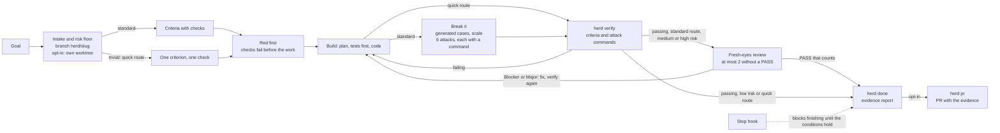

<p align="center">
  <picture>
    <source media="(prefers-color-scheme: dark)" srcset="assets/logo-dark.svg">
    
  </picture>
</p>

<h3 align="center">Hand an agent a goal. Get back code and proof.</h3>

<p align="center">
  <a href="https://github.com/Beovulfo/herd-sdlc/actions/workflows/ci.yml"></a>
  <a href="LICENSE"></a>
  
  
</p>

<p align="center">
  
  <br><sub>A real session with Herd 0.3.2 and Claude Sonnet 5.5, sped up: one message, then intake, criteria, red first, build, break it, review, verify and evidence. The Stop gate blocks one early finish.</sub>
</p>

Herd is a lightweight [Claude Code](https://claude.com/claude-code) plugin that runs a task end to end with as little human input as possible. You give it a goal and, if you like, success criteria. The agent plans, builds, tries to break its own work, verifies and gets a review. It only stops when **runnable checks prove the criteria pass**, and it only asks you something when an action is irreversible or a real trade-off needs a human.

## The problem

Most agent workflows ask people to write long requirement lists, then trust the agent when it says "done". Herd flips that: you give a goal and, if you like, success criteria; the agent returns the code and **evidence** (command output, commit SHA, timestamps). You review evidence, not process.

- **Done means proven.** A Stop hook blocks the agent from finishing until every check passes, with evidence newer than the last edit.
- **Your words stay yours.** Criteria you write are quoted verbatim and never weakened.
- **Caveats surface early.** The agent must try to break its own work and log what it finds.
- **Light.** A small Python CLI on the standard library, no dependencies, plain-text task files.

## Quickstart

You need Claude Code, Python 3.11 or newer as `python3`, and a git repository. CI tests Python 3.13 only.

```text
/plugin marketplace add Beovulfo/herd-sdlc
/plugin install herd@herd-sdlc
```

Then, inside your project, in a new session:

```text
/herd:run Add a --json flag to the export command. Output must be valid JSON with every row.
```

For a trivial change, say "quick fix". To plan how to prove a change for your project type, run `/herd:evidence`. More in the [Quickstart](https://github.com/Beovulfo/herd-sdlc/wiki/Quickstart) page.

## How it works



Every criterion has a `check`, a shell command where exit 0 means pass. The checks run once before any work and should fail. The agent then builds, tries to break the result with six standard attacks, verifies, and at medium and high risk gets a fresh-context review. `herd done` writes the evidence report. With `herd pr` (opt-in) that report is the pull request description; Herd never merges.

## Settings

All optional, in `herd.toml` at the project root. Without it, Herd uses these defaults.

| Table | Default | What it does |
| --- | --- | --- |
| `[floor]` | `high`: `migrations/**`, `auth/**`, `billing/**`, `herd.toml`; `medium`: `api/**`; any other path is medium | Risk floor by path; a high floor means one approval question and no quick route |
| `[review]` | `tiers = ["haiku", "sonnet", "opus"]`, `step = 1` | The reviewer is `step` tiers above the builder, capped at `sonnet`, never below the builder |
| `[worktree] required = true` | off | Every task starts in its own git worktree |
| `[pr] open = true` | off | Herd may push the task branch and open its pull request |

All settings: [Settings](https://github.com/Beovulfo/herd-sdlc/wiki/Settings).

## Learn more

- [How Herd works](https://github.com/Beovulfo/herd-sdlc/wiki/How-Herd-works): the steps, parallel tasks, architecture, autonomy rules
- [Example](https://github.com/Beovulfo/herd-sdlc/wiki/Example): a task, its evidence and its pull request
- [Attacks](https://github.com/Beovulfo/herd-sdlc/wiki/Attacks), [Review](https://github.com/Beovulfo/herd-sdlc/wiki/Review), [Hooks and guard](https://github.com/Beovulfo/herd-sdlc/wiki/Hooks-and-guard)
- [Commands](https://github.com/Beovulfo/herd-sdlc/wiki/Commands) and [Settings](https://github.com/Beovulfo/herd-sdlc/wiki/Settings)
- [Benchmark](https://github.com/Beovulfo/herd-sdlc/wiki/Benchmark): one task, with and without Herd, with its limits
- [Design and roadmap](https://github.com/Beovulfo/herd-sdlc/wiki/Design-and-roadmap), [requirements](docs/PRD.md), [changelog](CHANGELOG.md)

## Status

Version 0.12.12 (see the [changelog](CHANGELOG.md)). The local autopilot works and has unit tests that CI runs on Python 3.13. Not yet done: many live runs across project types, and issue-to-pull-request automation on GitHub. Checks run as shell commands with your permissions: read a task file as you read code.

## License

[Apache License 2.0](LICENSE)
