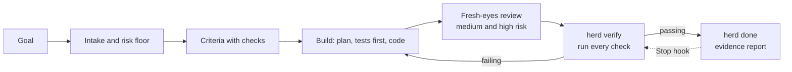

# Herd

**Hand an agent a goal. Get back code and proof.**

[](https://github.com/Beovulfo/herd-sdlc/actions/workflows/ci.yml)
[](LICENSE)


Herd is a lightweight Claude Code plugin that runs a task end to end with as little human input as possible. You give it a goal and, if you like, success criteria. The agent plans, builds, reviews and verifies on its own. It only stops when **runnable checks prove the criteria pass**, and it only asks you something when an action is irreversible or a real trade-off needs a human.

Most agent workflows ask humans to write long requirement lists and then trust the agent when it says "done". Herd flips that:

| Humans provide | Agents provide |
| --- | --- |
| A goal, and optionally criteria with a check for each | Plan, code, tests, review, and **evidence** |

You review evidence (command output, commit SHA, timestamp), not process.

## How it works



1. **Intake.** The task gets a folder, `.herd/tasks/<slug>/task.toml`, and a risk floor computed from path rules in `herd.toml` (migrations, auth, billing, and so on). The agent can raise the risk, never lower it.
2. **Criteria.** Every criterion is "Given, when, then" with a `check`: a shell command where exit 0 means pass. Criteria you write are authoritative. Criteria the agent adds are marked `agent-proposed`. A criterion with no check is `unchecked` and is never counted as met.
3. **Build.** Tests first, small steps, on a branch. Herd reuses [Superpowers](https://github.com/obra/superpowers) for planning, TDD and subagents when it is installed.
4. **Review.** For medium and high risk, a fresh-context reviewer looks at the diff: Superpowers code review, or the Goldfish agents from [EGM](https://github.com/google/elephant-goldfish-model) when installed.
5. **Verify.** `herd verify` runs every check and stores evidence: status, exit code, output tail, commit SHA, a fingerprint of the workspace, a timestamp.
6. **Stop gate.** While a task is active, a Stop hook refuses to let the agent finish unless the evidence is fresh and passing. Edit a file after verifying and the evidence is stale. After 3 blocked attempts the gate lets the agent stop so it can ask you one question instead of looping.

## Quickstart

You need [Claude Code](https://claude.com/claude-code), Python 3.13 or newer, and a git repository.

```text
/plugin marketplace add Beovulfo/herd-sdlc
/plugin install herd@herd-sdlc
```

Optional, and recommended: the plugins Herd builds on. Herd works without them and uses them when present.

```bash
claude plugin install superpowers@claude-plugins-official
claude plugin marketplace add google/elephant-goldfish-model
claude plugin install egm@egm
```

Then, inside your project:

```text
/herd:run Add a --json flag to the export command. Output must be valid JSON with every row.
```

Herd creates the task, writes criteria with checks (and shows them to you), runs them once to see them fail, builds on a `herd/<slug>` branch, gets a fresh-context review, verifies, and ends with an evidence report. For high-risk changes it asks one approval question before building. If you want to approve the criteria first on every task, say so in the request.

Try it without an agent, to see the harness itself:

```bash
python3 scripts/herd.py init slugify "Add a slugify(text) function"
# edit .herd/tasks/slugify/task.toml, add criteria with checks
python3 scripts/herd.py verify     # run the checks, store evidence
python3 scripts/herd.py done       # refuses unless evidence is fresh and passing
```

## A task file

```toml
goal = "Add a slugify(text) function"

[[criteria]]
id = "C1"
text = "Given 'Hello, World!', when slugify runs, then it returns 'hello-world'"
source = "human"
check = "python3 -m unittest test_textutil.TestSlugify.test_basic"

[[criteria]]
id = "C2"
text = "Given only punctuation, when slugify runs, then it returns an empty string"
source = "agent-proposed"
check = "python3 -m unittest test_textutil.TestSlugify.test_empty"
```

Before any work, both checks fail (that proves they test something). After the work:

```text
$ python3 scripts/herd.py verify
2 passing, 0 failing, 0 unchecked
  C1 passing: Given 'Hello, World!', when slugify runs, then it returns 'hello-world'
  C2 passing: Given only punctuation, when slugify runs, then it returns an empty string

$ python3 scripts/herd.py done
# Evidence: slugify
Result: 2 passing, 0 failing, 0 unchecked
| id | status | source | check |
| C1 | passing | human | `python3 -m unittest test_textutil.TestSlugify.test_basic` |
| C2 | passing | agent-proposed | `python3 -m unittest test_textutil.TestSlugify.test_empty` |
```

If the agent tries to finish while a check is failing, the Stop hook answers instead:

```text
{"decision": "block", "reason": "Herd task `slugify` is not done (1/3 stop attempts blocked).
 C1 is failing: Given 'Hello, World!', ... Run `herd.py verify` after fixing. ..."}
```

## Commands and skills

| What | Does |
| --- | --- |
| `/herd:run <task>` | The autopilot: intake, criteria, build, review, verify, evidence |
| `/herd:criteria` | Write success criteria with runnable checks |
| `/herd:evidence` | Interactive: decide with you how to prove the change works for your project type |
| `herd init <slug> "<goal>"` | Create a task and make it active |
| `herd init <slug> "<goal>" --quick "<check>"` | Quick route for a trivial change: one criterion, one check. Refused at a `high` risk floor |
| `herd check` | Validate `task.toml`; warns about checks that do not run project code |
| `herd detect` | Propose test and lint commands for Python, Node, Rust, Go and `make test` |
| `herd triage "<text>"` | Print the risk floor for a task description |
| `herd verify` | Run all checks, store `evidence.json`; exit 1 if any fail |
| `herd status` | Show evidence and whether the task is done |
| `herd done` | Write `evidence.md`, close the task; refuses unless fresh and passing |
| `herd gate` | The Stop hook (reads hook JSON on stdin) |
| `herd lint` | The optional PostToolUse lint hook; `herd lint --suggest` prints a `[lint]` block for `herd.toml` |

`herd` is `python3 scripts/herd.py`. Inside the plugin it is `python3 "${CLAUDE_PLUGIN_ROOT}/scripts/herd.py"`.

## Evidence that adapts to your project

`/herd:evidence` detects your project type, proposes the real test and lint commands for you to confirm, asks at most five questions about what "working" looks like and what cannot be automated, and drafts criteria with checks. The report then shows how many checks failed before the work started (a check that was green from the start is visible), and an optional `test_budget` line in `task.toml` records what is tested at which level and what is deliberately not tested.

## Lint feedback after each edit (opt-in)

Add a `[lint]` table to your project's `herd.toml`:

```toml
[lint]
command = "ruff check {file}"
globs = ["**/*.py"]
timeout_s = 20
```

While a Herd task is active, each `Edit` or `Write` runs the command on that file, and a failure is handed back to the agent as context (it does not block). Other editing tools such as `MultiEdit` and `NotebookEdit` are not covered. The command comes from the repository and runs with your permissions, the same trust as a `check` in `task.toml`.

## Autonomy rules

- **Gaps never block.** Missing criteria or checks are filled in by the agent, marked `agent-proposed`, and listed for you.
- **Evidence over claims.** `passing` and `failing` come from commands. `unchecked` is listed and never counted as met.
- **Ask rarely, ask once.** The agent stops for an irreversible action, a real trade-off, or when stuck after 3 review rounds or 3 failed attempts on a criterion. It asks one question with numbered options.
- **Decisions are reported** in at most three lines: decision, reason, how to override.
- **Checks run as shell commands** from `task.toml`, in your repository, with your permissions. Treat a task file like code: read it, especially in a repository you do not trust.

## Status

Version 0.2. Working and covered by 131 unit tests: the evidence harness (`scripts/herd.py`), the Stop gate, the quick route, project-type detection, the lint hook, and the risk-floor module. One trial run, where a fresh agent followed the `herd:run` skill text in a scratch repo, got a 5-criterion task to a passing `herd done`, and its notes on unclear wording were fixed. Not yet done: many live runs through the installed plugin, and issue-to-pull-request automation on GitHub, which is still design work.

## The design behind it

Herd is built with its own method, using the [Elephant-Goldfish Model](https://github.com/google/elephant-goldfish-model): an Elephant agent with full context drafts, and Goldfish reviewers with no context check. The requirements and decisions are in the open:

- [`PRD`](PRD%20%E2%80%94%20Autopilot%20SDLC%20plugin%20built%20on%20the%20Elephant-Goldfish%20Model.md): the product requirements, principles and roadmap.
- [`docs/designs/`](docs/designs): specs for Triage, the Arbiter (an agent that rules on review findings) and Escalation (one issue to pause and ask a human). Each has a tested module in `scripts/` that will power the GitHub automation phase.
- [`docs/spikes/`](docs/spikes): spike S1 ran EGM unattended on these three features, with every review report and what broke.

## Roadmap

- **Now (v0.1):** local autopilot with evidence and the Stop gate.
- **Next:** GitHub automation: a labelled issue becomes a reviewed spec, then a pull request, with the Arbiter and Escalation modules.
- **Later:** a release gate for high-risk changes, and other agent harnesses.

## Development

```bash
python3 -m unittest scripts.test_herd_cli scripts.test_herd_lint scripts.test_herd_detect \
  scripts.test_herd_triage scripts.test_herd_arbiter scripts.test_herd_escalation
claude plugin validate ./
```

Python standard library only, no dependencies. Try the plugin from a clone with `claude --plugin-dir /path/to/herd-sdlc`.

## License

[Apache License 2.0](LICENSE)
