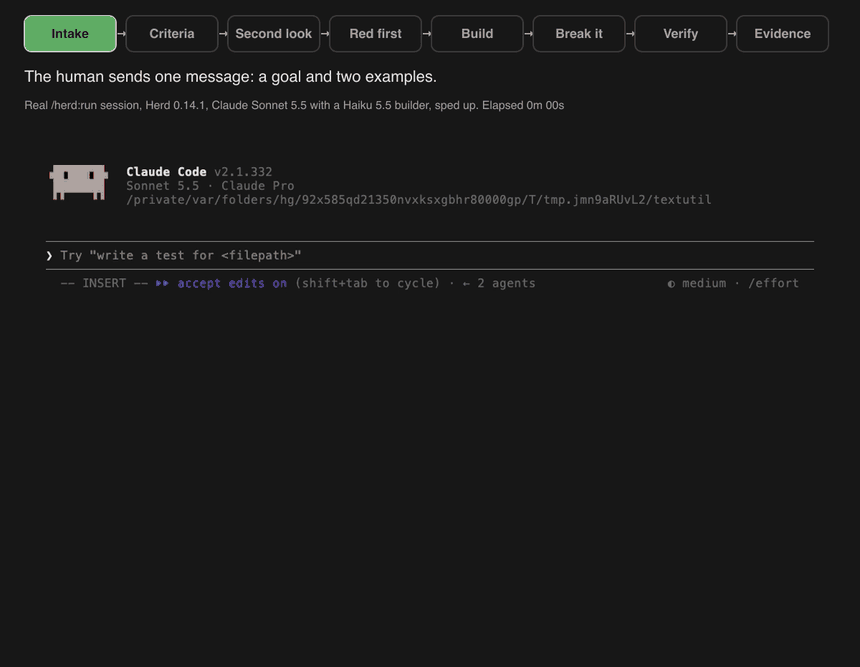
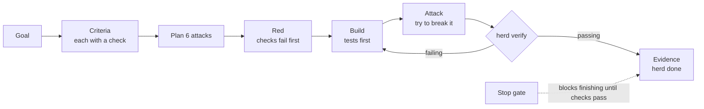

<p align="center">
  <picture>
    <source media="(prefers-color-scheme: dark)" srcset="assets/logo-dark.svg">
    
  </picture>
</p>

<h3 align="center">Hand an agent a goal. Get back code and proof.</h3>

<p align="center"><strong>Shift left, with autopilot.</strong></p>

<p align="center">
  <a href="https://github.com/Beovulfo/herd-sdlc/actions/workflows/ci.yml"></a>
  <a href="LICENSE"></a>
  
  
</p>

<p align="center">
  
  <br><sub>A real session with Herd 0.14.1, sped up: Claude Sonnet 5.5 designs, a Claude Haiku 5.5 subagent builds. The one red output is red first: the checks must fail before any code exists.</sub></p>

Herd is a [Claude Code](https://claude.com/claude-code) plugin. You give a goal; the agent plans, builds, tries to break its work and verifies.
It stops only when **runnable checks prove the criteria pass**, and returns code plus **evidence**: output, commit SHA, timestamps.
You review evidence, not process. A small Python CLI, standard library only.

## Quickstart

```text
/plugin marketplace add Beovulfo/herd-sdlc
/plugin install herd@herd-sdlc
```

You need Claude Code, Python 3.11 or newer as `python3`, and a git repository; `herd pr` also needs `gh`.
Then, in your project: `/herd:run Add a --json flag to the export command. Output must be valid JSON with every row.`
Trivial change? Say "quick fix". More: [Quickstart](https://github.com/Beovulfo/herd-sdlc/wiki/Quickstart).

## How it works



A check is a shell command: exit 0 means pass. Your criteria are quoted verbatim and never weakened.
Every step in detail: [docs/how-it-works.md](docs/how-it-works.md).

## Settings

Optional, in `herd.toml` at the project root. All of them: [Settings](https://github.com/Beovulfo/herd-sdlc/wiki/Settings).

| Table | Default |
| --- | --- |
| `[floor]` | `high`: `migrations/**`, `auth/**`, `billing/**`, `herd.toml`; `medium`: `api/**`; any other path is medium |
| `[models]` | `design = "sonnet"`, `build = "haiku"` |
| `[worktree] required = true` | off |
| `[pr] open = true` | off |

## Benchmark

A supermarket route optimizer, 6 runs per arm, mean ± sd. Method and limits: [BENCHMARK.md](examples/supermarket-route/BENCHMARK.md).

| Measure | Sonnet + Herd 0.3.1 | Sonnet, no plugin | Haiku + Herd 0.12.1 (real hooks) | Haiku, no plugin |
| --- | --- | --- | --- | --- |
| Valid stores, of 48 | 48.0 ± 0.0 | 45.2 ± 4.8 | 47.3 ± 1.6 | 41.7 ± 2.7 |
| Bad inputs handled, of 6 | 6.0 ± 0.0 | 3.5 ± 0.5 | 6.0 ± 0.0 | 4.3 ± 2.0 |
| Cost per run (USD) | 0.61 ± 0.09 | 0.29 ± 0.03 | 0.35 ± 0.13 | 0.04 ± 0.02 |

The 0.3.1 and no plugin columns used emulated sessions, the 0.12.1 arm real headless ones: the method differs.
In 0.14.0, a Sonnet design with a Haiku build scored 39.3 of 40 stores (tiers S, M, L), against 38.0 for Haiku alone.
The [changelog](CHANGELOG.md) does not state the run count for this. [bus-transfer](examples/bus-transfer) has no recorded legs yet.

## Use cases

| Project | Task |
| --- | --- |
| [supermarket-route](examples/supermarket-route) | the best route through a supermarket for a shopping list |
| [bus-transfer](examples/bus-transfer) | an earliest-arrival bus transfer planner |
| poi_entry_point | a private research project: where cars enter fuel stations, from open map data (Overture Maps, OpenStreetMap) |

## Learn more

- [How it works in detail](docs/how-it-works.md): models, settings, attacks, benchmark notes
- Wiki: [How Herd works](https://github.com/Beovulfo/herd-sdlc/wiki/How-Herd-works), [Example](https://github.com/Beovulfo/herd-sdlc/wiki/Example), [Attacks](https://github.com/Beovulfo/herd-sdlc/wiki/Attacks), [Hooks and guard](https://github.com/Beovulfo/herd-sdlc/wiki/Hooks-and-guard), [Commands](https://github.com/Beovulfo/herd-sdlc/wiki/Commands), [Benchmark](https://github.com/Beovulfo/herd-sdlc/wiki/Benchmark), [Design and roadmap](https://github.com/Beovulfo/herd-sdlc/wiki/Design-and-roadmap)
- [Design eval](examples/design-eval/README.md), [requirements](docs/PRD.md), [changelog](CHANGELOG.md)

## Contributing

Questions: [GitHub Discussions](https://github.com/Beovulfo/herd-sdlc/discussions). Setup, checks and rules: [CONTRIBUTING.md](CONTRIBUTING.md).
New here? Try a [good first issue](https://github.com/Beovulfo/herd-sdlc/labels/good%20first%20issue).

## Status

Version 0.14.2 (see the [changelog](CHANGELOG.md)). The local autopilot works; CI runs its unit tests on Python 3.13.
Not yet done: many live runs across project types, and issue-to-pull-request automation on GitHub.
Checks run as shell commands with your permissions: read a task file as you read code.

## License

[Apache License 2.0](LICENSE)
