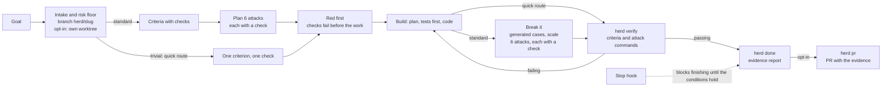

<p align="center">
  <picture>
    <source media="(prefers-color-scheme: dark)" srcset="assets/logo-dark.svg">
    
  </picture>
</p>

<h3 align="center">Hand an agent a goal. Get back code and proof.</h3>

<p align="center"><strong>Shift left, with autopilot.</strong></p>

<p align="center">
  <a href="https://github.com/Beovulfo/herd-sdlc/actions/workflows/ci.yml"></a>
  <a href="LICENSE"></a>
  
  
</p>

<p align="center">
  
  <br><sub>A real session with Herd 0.14.0, sped up: Claude Sonnet 5.5 designs and checks, and a Claude Haiku 5.5 subagent builds. One message, then criteria, a second look at the request, checks that fail before any code, the build, attacks that find bugs the passing checks missed, and the evidence. The Stop gate blocks early finishes while the builder runs.</sub>
</p>

Herd is a lightweight [Claude Code](https://claude.com/claude-code) plugin that runs a task end to end with as little human input as possible. You give it a goal and, if you like, success criteria. The agent plans, builds, tries to break its own work, and verifies. It only stops when **runnable checks prove the criteria pass**, and it only asks you something when an action is irreversible or a real trade-off needs a human.

## The problem

Most agent workflows ask people to write long requirement lists, then trust the agent when it says "done". Herd flips that: you give a goal and, if you like, success criteria; the agent returns the code and **evidence** (command output, commit SHA, timestamps). You review evidence, not process.

- **Done means proven.** A Stop hook blocks the agent from finishing until every check passes, with evidence newer than the last edit.
- **Your words stay yours.** Criteria you write are quoted verbatim and never weakened.
- **Caveats surface early.** The agent must try to break its own work and log what it finds.
- **Light.** A small Python CLI on the standard library, no dependencies, plain-text task files.

## Quickstart

You need Claude Code, Python 3.11 or newer as `python3`, and a git repository; `herd pr` also needs `gh`. CI tests Python 3.13 only.

By default Sonnet designs and Haiku builds: see [Models](#models).

```text
/plugin marketplace add Beovulfo/herd-sdlc
/plugin install herd@herd-sdlc
```

Then, inside your project, in a new session:

```text
/herd:run Add a --json flag to the export command. Output must be valid JSON with every row.
```

For a trivial change, say "quick fix". To plan how to prove a change for your project type, run `/herd:evidence`. More in the [Quickstart](https://github.com/Beovulfo/herd-sdlc/wiki/Quickstart) page.

## How it works



Every criterion has a `check`, a shell command where exit 0 means pass. Before any code, the agent also logs six standard attacks, so they shape the design. On the standard route the first `herd verify` refuses while one has no note. For `recount`, `refusal` and `other-reading`, `--covered-by <criterion id>` reuses a criterion's check instead of a second test. The agent also solves one tiny case by hand: that answer is frozen before any code (`--expect`), and the real program's output must contain it. The checks run once before any work and should fail. `herd verify` runs no check when the work, `task.toml` and the attack notes are unchanged since the last full run; `--fresh` runs them all. Untrusted input is refused, not tolerated: contradictory entries, or a broken entry that could change a requested answer, end in an error, not a warning with exit 0. The agent then builds, tries to break the result and verifies. No second model reviews the change: bugs outside the attacks and criteria are not caught. `herd done` writes the evidence report. With `herd pr` (opt-in) that report is the pull request description; Herd never merges.

## Models

On the standard route Herd designs on one model and builds on another. The defaults are Sonnet for design and Haiku for the build. Change them in `herd.toml` at the project root:

```toml
[models]
design = "sonnet"   # criteria, the "be specific" second look, the six attacks, the first verify
build = "haiku"     # the code
```

Each takes a tier (`haiku`, `sonnet`, `opus`) or a model name, and matches any model id that contains it. The values are read at `herd init`. `herd status` prints both and says what runs in your session and what in a subagent. When your session's model is the `design` model, it designs itself. `herd done` refuses a design that was not made on the `design` model.

## Settings

All optional, in `herd.toml` at the project root. Without it, Herd uses these defaults.

| Table | Default | What it does |
| --- | --- | --- |
| `[floor]` | `high`: `migrations/**`, `auth/**`, `billing/**`, `herd.toml`; `medium`: `api/**`; any other path is medium | Risk floor by path; a high floor means one approval question and no quick route |
| `[models]` | `design = "sonnet"`, `build = "haiku"` | Which model designs and which builds ([Models](#models)) |
| `[worktree] required = true` | off | Every task starts in its own git worktree |
| `[pr] open = true` | off | Herd may push the task branch and open its pull request |

All settings: [Settings](https://github.com/Beovulfo/herd-sdlc/wiki/Settings).

## Benchmark

The task is a route optimizer for picking a shopping list in a supermarket, run with Claude Sonnet 5.5 and Claude Haiku 5.5, 6 runs each. Cells are mean ± sd.

| Measure | Sonnet + Herd 0.3.1 | Sonnet, no plugin | Haiku + Herd 0.12.1 (real hooks) | Haiku, no plugin |
| --- | --- | --- | --- | --- |
| Valid stores, of 48 | 48.0 ± 0.0 | 45.2 ± 4.8 | 47.3 ± 1.6 | 41.7 ± 2.7 |
| Bad inputs handled, of 6 | 6.0 ± 0.0 | 3.5 ± 0.5 | 6.0 ± 0.0 | 4.3 ± 2.0 |
| Cost per run (USD) | 0.61 ± 0.09 | 0.29 ± 0.03 | 0.35 ± 0.13 | 0.04 ± 0.02 |

The 0.3.1 round, including both no plugin columns, used emulated sessions; the 0.12.1 arm used real headless sessions, so the two differ in method.

In 0.14.0 (see [changelog](CHANGELOG.md)), end to end, a Sonnet design with a Haiku build scored 39.3 of 40 stores on tiers S, M, L, against 38.0 for Haiku alone; the changelog does not state the run count for this.

Full results and limits: [BENCHMARK.md](examples/supermarket-route/BENCHMARK.md). The [bus-transfer](examples/bus-transfer) task and its hidden verifier exist, but there are no recorded legs in the repository yet.

## Use cases

- [supermarket-route](examples/supermarket-route): the best route through a supermarket for a shopping list.
- [bus-transfer](examples/bus-transfer): an earliest-arrival bus transfer planner.
- poi_entry_point: a private research project built with Herd that finds where cars enter fuel stations, from open map data (Overture Maps, OpenStreetMap).

## Learn more

- [How Herd works](https://github.com/Beovulfo/herd-sdlc/wiki/How-Herd-works): the steps, parallel tasks, architecture, autonomy rules
- [Example](https://github.com/Beovulfo/herd-sdlc/wiki/Example): a task, its evidence and its pull request
- [Attacks](https://github.com/Beovulfo/herd-sdlc/wiki/Attacks), [Hooks and guard](https://github.com/Beovulfo/herd-sdlc/wiki/Hooks-and-guard)
- [Commands](https://github.com/Beovulfo/herd-sdlc/wiki/Commands) and [Settings](https://github.com/Beovulfo/herd-sdlc/wiki/Settings)
- [Benchmark](https://github.com/Beovulfo/herd-sdlc/wiki/Benchmark): one task, with and without Herd, with its limits
- [Design eval](examples/design-eval/README.md): do a challenger's questions fix design mistakes before the build?
- [Design and roadmap](https://github.com/Beovulfo/herd-sdlc/wiki/Design-and-roadmap), [requirements](docs/PRD.md), [changelog](CHANGELOG.md)

## Contributing

Questions go to [GitHub Discussions](https://github.com/Beovulfo/herd-sdlc/discussions). See [CONTRIBUTING.md](CONTRIBUTING.md) for setup, checks and rules. New contributors can start with the [good first issue](https://github.com/Beovulfo/herd-sdlc/labels/good%20first%20issue) label.

## Status

Version 0.14.0 (see the [changelog](CHANGELOG.md)). The local autopilot works and has unit tests that CI runs on Python 3.13. Not yet done: many live runs across project types, and issue-to-pull-request automation on GitHub. Checks run as shell commands with your permissions: read a task file as you read code.

## License

[Apache License 2.0](LICENSE)
