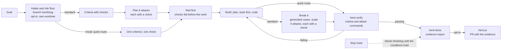

# How Herd works

The detail behind the [README](../README.md): the problem, each step of a run, models, settings and benchmark notes.

## The problem

Most agent workflows ask people to write long requirement lists, then trust the agent when it says "done". Herd flips that: you give a goal and, if you like, success criteria; the agent returns the code and **evidence** (command output, commit SHA, timestamps). You review evidence, not process.

- **Done means proven.** A Stop hook blocks the agent from finishing until every check passes, with evidence newer than the last edit. It blocks the session that ran `herd init` and the last session to run a herd command in that checkout, such as one that continues the task. Any other, such as a parent that spawned the session into the same worktree and ran no herd command, stops freely.
- **Your words stay yours.** Criteria you write are quoted verbatim and never weakened.
- **Caveats surface early.** The agent must try to break its own work and log what it finds.
- **Light.** A small Python CLI on the standard library, no dependencies, plain-text task files.

Herd only asks you something when an action is irreversible or a real trade-off needs a human.

## Quickstart notes

CI tests Python 3.11, 3.12 and 3.13. For a trivial change, say "quick fix". To plan how to prove a change for your project type, run `/herd:evidence`.

## The run



`herd init` records your request itself: the text of your latest `/herd:run` message in the session log. `--request` counts only when there is none; a differing one is kept as a decision note.

Every criterion has a `check`, a shell command where exit 0 means pass. Before any code, the agent also logs six standard attacks, so they shape the design. On the standard route the first `herd verify` refuses while one has no note. For `recount`, `refusal` and `other-reading`, `--covered-by <criterion id>` reuses a criterion's check instead of a second test.

The agent also solves one tiny case by hand: that answer is frozen before any code (`--expect`), and the real program's output must contain it. The checks run once before any work and should fail. `herd verify` runs no check when the work, `task.toml` and the attack notes are unchanged since the last full run; `--fresh` runs them all.

Each verify records how long every criterion and attack check took (`seconds` in `evidence.json`). The report shows each criterion's time as `(N s)`, and `herd verify` prints the total and names any check over 60 s. The time is evidence only: it never fails a criterion.

A limit logged with `herd note --open` gets a number. Once it is resolved, `herd note --fixed --closes N "text"` closes it: it leaves "Not proven" in the final report and the PR, and shows under "Caveats" as closed.

Untrusted input is refused, not tolerated: contradictory entries, or a broken entry that could change a requested answer, end in an error, not a warning with exit 0. The agent then builds, tries to break the result and verifies. No second model reviews the change: bugs outside the attacks and criteria are not caught.

The designer and builder subagents must run in the foreground: the guard denies `herd:herd-designer` or `herd:herd-builder` with `run_in_background` not `false`, with or without a task, because a main session that waits on one tries to stop and uses up the Stop gate.

`herd done` writes the evidence report. With `herd pr` (opt-in) that report is the pull request description; Herd never merges. Once the PR exists, every `herd verify` rewrites that description from the latest evidence (body only; a failed `gh` call is one warning line). Lines after Herd's footer line, such as `Closes #N`, are kept, also by `herd pr` and `herd done`. `herd pr --draft` opens a draft and `--milestone NAME` sets the milestone, on a new or an open PR; a flag left out changes nothing, and any other flag is refused before anything is pushed. During a task the guard denies `git push` and names `herd pr` instead.

## Models

On the standard route Herd designs on one model and builds on another. The defaults are Sonnet for design and Haiku for the build. Change them in `herd.toml` at the project root:

```toml
[models]
design = "sonnet"   # criteria, the "be specific" second look, the six attacks, the first verify
build = "haiku"     # the code
```

Each takes a tier (`haiku`, `sonnet`, `opus`) or a model name, and matches any model id that contains it. The values are read at `herd init`. `herd status` prints both and says what runs in your session and what in a subagent. When your session's model is the `design` model, it designs itself. `herd done` refuses a design that was not made on the `design` model.

## Settings

All optional, in `herd.toml` at the project root. Without it, Herd uses these defaults.

| Table | Default | What it does |
| --- | --- | --- |
| `[floor]` | `high`: `migrations/**`, `auth/**`, `billing/**`, `herd.toml`; `medium`: `api/**`; any other path is medium | Risk floor by path; a high floor means one approval question and no quick route |
| `[models]` | `design = "sonnet"`, `build = "haiku"` | Which model designs and which builds ([Models](#models)) |
| `[worktree] required = true` | off | Every task starts in its own git worktree |
| `[pr] open = true` | off | Herd may push the task branch and open its pull request |

All settings: [Settings](https://github.com/Beovulfo/herd-sdlc/wiki/Settings).

## Benchmark notes

The task is a route optimizer for picking a shopping list in a supermarket, run with Claude Sonnet 5.5 and Claude Haiku 5.5, 6 runs each. The 0.3.1 round, including both no plugin columns, used emulated sessions; the 0.12.1 arm used real headless sessions, so the two differ in method.

In 0.14.0 (see [changelog](../CHANGELOG.md)), end to end, a Sonnet design with a Haiku build scored 39.3 of 40 stores on tiers S, M, L, against 38.0 for Haiku alone; the changelog does not state the run count for this.

Full results and limits: [BENCHMARK.md](../examples/supermarket-route/BENCHMARK.md). The [bus-transfer](../examples/bus-transfer) task and its hidden verifier exist, but there are no recorded legs in the repository yet.
