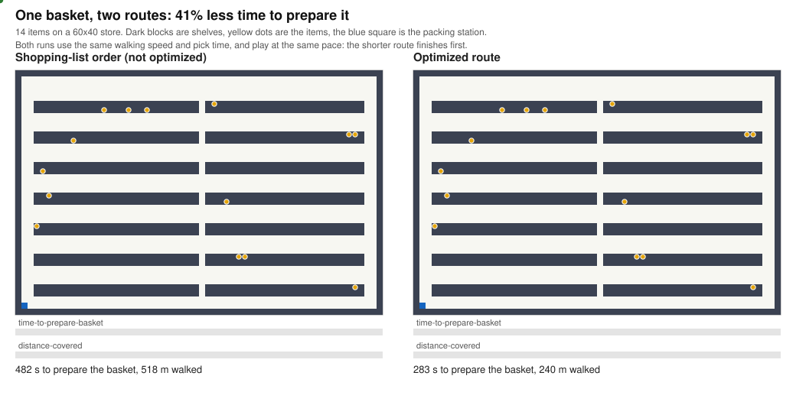
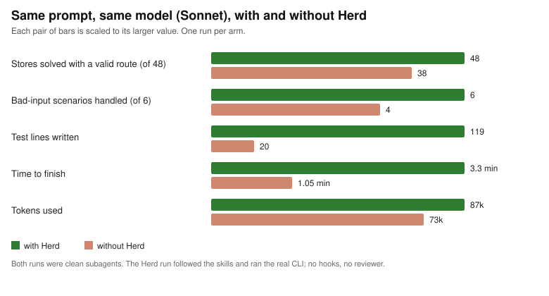

# Benchmark: the same prompt with and without Herd

**Question.** Given one short prompt, does an agent that follows Herd produce a better result than the same model with no workflow? Does that hold for a small model? What does each cost?

**Task.** A route optimizer for a delivery person who picks a customer's shopping list inside a supermarket. It reads the store map and the list, finds the best route, simulates it step by step with live `time-to-prepare-basket` and `distance-covered`, and shows it saves more than 30 percent of the time against the list-order route. The prompt ([`prompt.md`](prompt.md)) is one paragraph, the way a person would ask in a vibe-coding session: it asks for something that works for any supermarket, even very big ones, whatever its layout, and gives no file formats, no scale numbers and no test requirements.



## The runs

Four arms, **6 runs each**, 24 runs in all, on 2026-11-23.

| Arm | Model | Input | Runs |
| --- | --- | --- | --- |
| Sonnet + Herd | Claude Sonnet 5.5 | the prompt, as `/herd:run <prompt>`, with **Herd 0.3.1** (commit `d4f11c6`) | [`runs/sonnet-herd-1`](runs/sonnet-herd-1) to `-6` |
| Sonnet, no workflow | Claude Sonnet 5.5 | the prompt, nothing else | [`runs/sonnet-plain-1`](runs/sonnet-plain-1) to `-6` |
| Haiku + Herd | Claude Haiku 5.5 | the prompt, as `/herd:run <prompt>`, with Herd 0.3.1 | [`runs/haiku-herd-1`](runs/haiku-herd-1) to `-6` |
| Haiku, no workflow | Claude Haiku 5.5 | the prompt, nothing else | [`runs/haiku-plain-1`](runs/haiku-plain-1) to `-6` |

Every run is a clean subagent in its own empty git repository, told only that Python's standard library is allowed, that nobody will answer questions and that it cannot spawn subagents. A Herd run read the run skill and ran the real `herd` CLI; its task file, evidence report and caveat log are in its `herd-task/` folder. It is an emulation of a live session: no Stop hook fired and no fresh-context review happened.

## How the results were checked

No run saw these checks.

- **Hidden general verifier** ([`verifier/verify_general.py`](verifier/verify_general.py)). It generates 48 stores from eight layout families (parallel aisles, vertical aisles, islands, random obstacles, comb, L-shape, maze corridors, department rooms) at four sizes: 16 small (60 by 40 cells, 7 items), 16 mid (160 by 100, 40 items), 8 large (400 by 300, 100 items) and 8 extra large (600 by 400, 200 items). It asks each solution for both routes as cell-by-cell traces and validates every one itself: legal moves, no walls, every item reached, distance and time recomputed. A store counts as valid only if it finished within the time limit (30, 90, 180 and 300 seconds) with both routes valid. Its own tests use a reference solution and two cheating variants that it must reject.
- **Robustness probe** ([`verifier/robustness_probe.py`](verifier/robustness_probe.py), run through [`verifier/probe_runs.py`](verifier/probe_runs.py)). The same small store with six scenarios through each solution's own command line: a normal run, an unknown product, a duplicate, an empty list, an unreachable product and a malformed map. A traceback counts as unhandled.
- **Adapters** ([`runs/adapters/`](runs/adapters)). Every run chose its own file formats and functions, so a separate agent wrote one small adapter per run from a fixed spec ([`verifier/ADAPTER_SPEC.md`](verifier/ADAPTER_SPEC.md)). An adapter translates the verifier's store into the run's own format and calls the run's own planner and simulator; it must not fix or work around anything. Two adapter mistakes were found while scoring and fixed (a probe map that skipped the spec's translation, and a route marked as a round trip that by design ends at the last pick); the scores below are from the fixed adapters.
- **Cost** comes from each run's own log of model requests (input, output, cache-read and cache-write tokens), priced at Anthropic API list prices: Sonnet 5.5 at $2 / $10 per million input / output tokens, $0.10 cache reads, $2.50 cache writes; Haiku 5.5 at $0.10 / $0.50 for prompts up to 100K tokens and $0.50 / $2.50 above. Haiku cache prices assume the usual multipliers (reads 0.1 times, writes 1.25 times input). Rates are from the Claude API reference cached on 2026-11-03.

## Results



Mean ± standard deviation over the 6 runs of each arm ([`verifier/aggregate.py`](verifier/aggregate.py)):

| Measure | Sonnet + Herd | Sonnet, no workflow | Haiku + Herd | Haiku, no workflow |
| --- | --- | --- | --- | --- |
| **Valid stores, of 48** | **48.0 ± 0.0** | 45.2 ± 4.8 | 44.3 ± 2.0 | 41.7 ± 2.7 |
| Runs with all 48 valid | **6 of 6** | 3 of 6 | 1 of 6 | 0 of 6 |
| **Bad-input scenarios handled, of 6** | **6.0 ± 0.0** | 3.5 ± 0.5 | **6.0 ± 0.0** | 4.3 ± 2.0 |
| Valid small stores, of 16 | 16.0 ± 0.0 | 15.3 ± 1.2 | 15.8 ± 0.4 | 15.7 ± 0.5 |
| Valid mid stores, of 16 | 16.0 ± 0.0 | 15.3 ± 1.6 | 13.5 ± 1.2 | 13.2 ± 0.8 |
| Valid large stores, of 8 | 8.0 ± 0.0 | 7.2 ± 1.3 | 7.8 ± 0.4 | 7.2 ± 1.0 |
| Valid extra-large stores, of 8 | 8.0 ± 0.0 | 7.3 ± 0.8 | 7.2 ± 0.4 | 5.7 ± 2.3 |
| Time saved against list order, small (%) | 25.0 ± 0.9 | 25.5 ± 2.1 | 30.1 ± 3.4 | 26.8 ± 3.0 |
| Time saved, mid (%) | 66.8 ± 1.3 | 66.7 ± 1.1 | 68.2 ± 1.8 | 66.8 ± 1.4 |
| Time saved, large (%) | 78.4 ± 0.6 | 80.2 ± 3.1 | 79.1 ± 0.8 | 77.7 ± 1.4 |
| Time saved, extra large (%) | 83.5 ± 0.6 | 82.9 ± 0.6 | 83.7 ± 0.7 | 84.1 ± 3.8 |
| Median time to plan an extra-large store (s) | 63.7 ± 33.9 | 94.2 ± 50.0 | 69.9 ± 31.3 | 49.1 ± 15.5 |
| Time to a finished result (min) | 4.2 ± 1.2 | 1.1 ± 0.2 | 10.3 ± 5.5 | 2.7 ± 0.9 |
| Tool calls | 16 ± 4 | 3 ± 2 | 34 ± 9 | 9 ± 2 |
| Model requests | 17 ± 4 | 4 ± 2 | 31 ± 9 | 8 ± 2 |
| Output tokens (thousands) | 23.4 ± 4.1 | 8.4 ± 1.5 | 65.8 ± 10.9 | 27.6 ± 5.1 |
| Tokens read, including cache (thousands) | 1457 ± 369 | 255 ± 136 | 3576 ± 1315 | 663 ± 150 |
| **Estimated cost per run (USD)** | **0.61 ± 0.09** | 0.29 ± 0.03 | **0.29 ± 0.09** | 0.04 ± 0.02 |

### What the numbers say

- **Sonnet with Herd had no failure in 6 runs.** Every run produced a valid route on all 48 stores and handled all six bad inputs, with zero spread. Without Herd, Sonnet was right 3 times out of 6: the other runs lost 1 to 12 stores, and every one of the six crashed on a malformed map.
- **Herd made bad input safe on both models.** All 12 Herd runs handled 6 of 6 probe scenarios; the 12 runs without it averaged 3.5 (Sonnet) and 4.3 (Haiku). This is what Herd's enforced attacks ask for, so read it as Herd doing what it says.
- **Herd helps Haiku less on route validity.** Haiku with Herd solved 44.3 stores, against 41.7 without. Its failures are one bug class, below.
- **Route quality is the same in every arm.** Once a store is solved, the time saved against list order is within a few points across all four arms. Herd buys robustness and evidence, not a better optimizer.
- **Herd costs about twice as much on Sonnet and eight times as much on Haiku.** A Herd run makes about 4 times as many model requests and reads 5 to 6 times as many tokens. On Haiku, many of those requests carry more than 100K tokens of context, where Haiku's price is five times higher.

### Is Haiku cheaper and as good?

| | Cost per run | Valid stores, of 48 | Bad inputs handled, of 6 | Runs fully clean |
| --- | --- | --- | --- | --- |
| Sonnet + Herd | $0.61 | 48.0 | 6.0 | 6 of 6 |
| Haiku + Herd | $0.29 | 44.3 | 6.0 | 1 of 6 |
| Sonnet, no workflow | $0.29 | 45.2 | 3.5 | 0 of 6 |
| Haiku, no workflow | $0.04 | 41.7 | 4.3 | 0 of 6 |

- **Cheaper, yes; the same results, no.** Haiku with Herd costs half as much as Sonnet with Herd and matches it on bad input, but fails 3.7 stores per run on average and was fully clean once in 6 runs.
- **For the same money, Haiku with Herd beats Sonnet without it on safety.** Both cost $0.29. Haiku with Herd handles every bad input (6.0 against 3.5) and solves about as many stores (44.3 against 45.2).
- **Haiku with no workflow is the cheapest by far** ($0.04, 15 times cheaper than Sonnet with Herd) and the least reliable.

### Why stores fail

- **One bug class explains almost every lost store: a sealed shelf side.** In the random-obstacle and department layouts, a shelf can border a pocket of floor that the picker cannot reach. A solution that always picks from one fixed side of the shelf (the first free neighbour) reports the product as unreachable although another side is open. Of the 77 lost stores in all 24 runs, 55 are this crash. The rest are timeouts (15, in three runs without Herd), a reported time that does not match the route (6, in two Sonnet runs without Herd) and one product the run refused because no free cell was next to it.
- **For 7 Haiku runs, the shelf side was chosen by the adapter.** Their map format takes the pick cell itself, not the shelf, so the adapter had to choose a side: by the spec it took the first free neighbour, as a naive user would, with no reachability check. That caused 28 of the lost stores (4 each in Haiku + Herd runs 3 to 6, Haiku without workflow runs 1, 3 and 4). Counting those 28 as solved, Haiku + Herd would solve 47.0 ± 2.4 stores and Haiku without workflow 43.7 ± 4.6. The Sonnet arms are unaffected.
- **Herd's attacks did not catch it in the Haiku runs.** The sealed side is a "disconnected" input. Herd's adversarial pass lists it among the extremes to try, but it is not one of the four enforced attacks, and several Haiku runs logged it as a known limit ("picked from the first walkable neighbour, not the better side") without testing whether it breaks the claim.

## What this does not show

- **One task.** Six runs per arm measure the spread of results on this task, not on other kinds of work.
- **The Herd runs are emulations.** No Stop hook fired and no fresh-context review happened, which a live session adds. Several Herd runs wrote code before their criteria and produced the "failed first" step by moving the code aside; their reports say so.
- **The no-workflow agents were not asked to test.** They might handle these cases if asked.
- **Timing is noisy.** Up to 12 runs were built at the same time and up to 5 were scored at the same time on one machine, so build times and plan times carry load from the others. Plan-time spreads are large for every arm.
- **Shared configuration.** All runs used the same Claude Code installation and global settings, so both arms in each pair saw the same environment.
- **Costs are estimates at list prices.** A subscription, a discount or a different cache mix changes them; the ratios between arms are the more stable figure.
- **Time saved is not compared like for like everywhere.** Some solutions end the route at the last pick and others return to the start; the verifier scores each against its own list-order route.

## History

The first version of this benchmark used one run per arm with Sonnet and Herd 0.2.4. Its two solutions are kept in [`with-herd/`](with-herd) and [`without-herd/`](without-herd) (Herd: 48 of 48 stores and 6 of 6 probe scenarios; without: 38 of 48 and 4 of 6), and the images are drawn from the first one. Its full write-up is in git history at commit `d4f11c6`.

## Reproduce

From the repository root. Scoring one run takes a few minutes; the extra-large stores take the longest.

```bash
sh examples/supermarket-route/verifier/score_run.sh sonnet-herd-1
```

```bash
python3 examples/supermarket-route/verifier/aggregate.py
```

```bash
python3 examples/supermarket-route/images/make_images.py
```

The raw output of every run is in [`runs/results/`](runs/results), and per-run tokens, requests, tool calls, time and cost are in [`runs/usage.json`](runs/usage.json).
