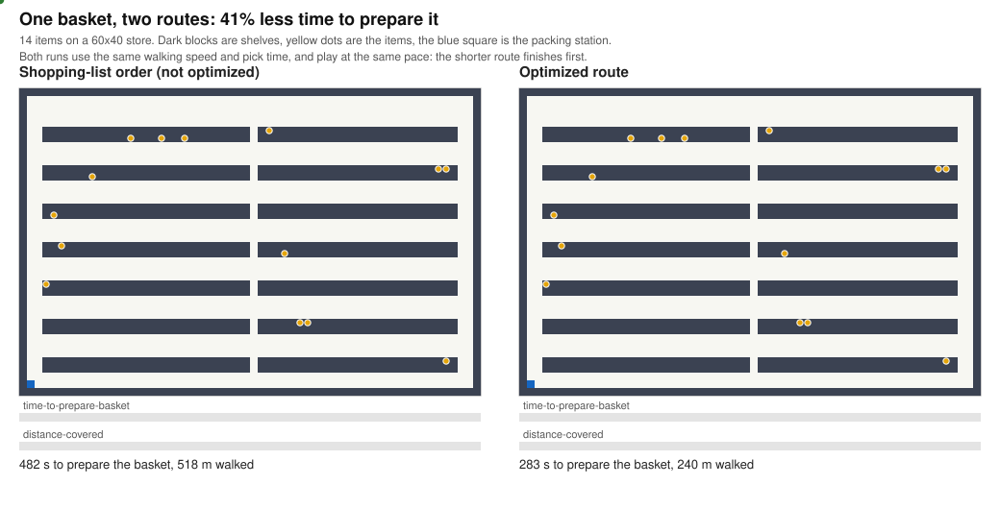

# Example: a supermarket route optimizer

One benchmark: the same prompt, given 6 times each to four arms (Claude Sonnet 5.5 and Claude Haiku 5.5, each with Herd 0.3.1 and with no workflow). Start with [`BENCHMARK.md`](BENCHMARK.md).

| | |
| --- | --- |
| [`BENCHMARK.md`](BENCHMARK.md) | method, results with mean and standard deviation, cost, failure analysis, limits |
| [`prompt.md`](prompt.md) | the prompt every run received |
| [`runs/`](runs) | the 24 runs: code, Herd task records (`herd-task/`), adapters, raw results, tokens and cost (`usage.json`) |
| [`verifier/`](verifier) | the hidden general verifier, the robustness probe, the adapter spec, the scoring and aggregation scripts |
| [`images/`](images) | the three images, and the script that draws them |
| [`with-herd/`](with-herd), [`without-herd/`](without-herd), [`results/`](results) | the first version of the benchmark: one Sonnet run per arm with Herd 0.2.4 |
